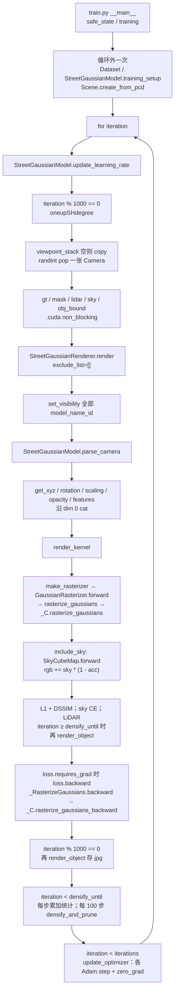

# 一次训练迭代的调用链

范围：当前仓库里的 `street_gaussians`，入口 `python train.py --config configs/example/waymo_train_002.yaml`。主链是这条 yaml 的默认路径：`schedule.enable=false`，`complexity_enable=false`，其余 schedule 开关也是默认 false。这时 `get_update_exclude_list` 和 `get_raster_exclude_list` 都返回 `[]`。

数字阈值（25000、100、3000、50000 等）来自 `configs/example/waymo_train_002.yaml`，缺的项用 `lib/config/config.py` 的默认值。`docs/streetgs_training_profile.md` 的行号和「exclude 未接入」「CUDA Event 从未 elapsed」已过时，下文不沿用。

B0 的分阶段墙钟（backward 76.74 ms、parse 22.61、H2D 20.58、Adam 11.17 等）不在本仓库的代码、文档或日志里。下表对应列一律「待查」。没有把这些名字配到某个函数上。

## 主链



`iter_start.record()` 在学习率更新之前，`iter_end.record()` 在 `backward` 之后、存图和 densify 之前。`log_time=true` 时打印的 `cuda_fwd_bwd_ms` 只盖住这一段，不含 densify 和 Adam。默认 `log_time=false`，事件只 record，不读 `elapsed_time`。

## 1. 取样

没有 `DataLoader`，也没有 sampler 类。`cfg.train.importance_sampling` 只在 `lib/config/config.py` 里设为 false，`train.py` 不读它。

循环外：

1. `Dataset.__init__` → `readWaymoFullInfo`（`data.type: Waymo`）。
2. `get_val_frames(..., train_every=1)`：`split_train: 1` 时每个 frame index 都进 train，`test_cameras` 为空。
3. `Dataset` 在 `cfg.data.shuffle`（默认 true）时把 `train_cameras` 洗一次。
4. `cameraList_from_camInfos` → `loadCam` → `Camera`。`resolution_scales` 默认 `[1]`。`loadCam` 里 `scale = min(1, 1600 / orig_w) / resolution_scale`。源图像宽高不在仓库里，具体 H、W 待查。
5. `Scene.getTrainCameras()` 返回 `dataset.train_cameras[1.0]`。

每步（`training` 循环）：

```text
if not viewpoint_stack:
    viewpoint_stack = scene.getTrainCameras().copy()
viewpoint_cam = viewpoint_stack.pop(randint(0, len(viewpoint_stack) - 1))
```

无放回抽完一轮再整表复制。复制的是 Python 列表，`Camera` 对象本身复用。

一张 `Camera` 的时刻来自 `waymo_full_readers` 写入的 `metadata`：`frame`、`frame_idx`、`cam`（yaml 的 `cameras: [0, 1, 2]`）、`timestamp`、`is_val`。`ego_pose` 在 `Camera.__init__` 里变成 CUDA 张量后从 `meta` 删掉，之后用 `camera.ego_pose`。

跨步：相机列表和已经建好的位姿矩阵、K、`world_view_transform` 留在对象上。图像默认不常驻 GPU（`cfg.to_cuda` 默认 false；`Scene` 只在它为 true 时 `set_device('cuda')`）。没有「静止车 / 重复视角跳过本步」的分支。

## 2. 场景组装

`StreetGaussianRenderer.render`：

1. `include_list = model_name_id.keys() - exclude_list`。默认 exclude 为空，包含 `background` 和每个 `obj_{track_id:03d}`。`sky` 不在这个字典里，天空不是高斯。
2. `set_visibility(include_list)`。
3. `parse_camera(camera)`。每次调用都把 `num_gaussians`、`graph_gaussian_range`、`graph_obj_list` 清掉重算，没有读上一帧的 graph。

`parse_camera`：

- `self.frame = camera.meta['frame']`。
- `background.set_background_mask` 的函数体是 `pass`。`background_mask` 保持 None，背景高斯整块进入。
- 背景可见时，`graph_gaussian_range['background'] = [0, N_bkgd)`，`N_bkgd = background.get_xyz.shape[0]`。
- actor：`start_frame <= frame <= end_frame` 且 `get_visibility(obj_name)` 才进入 `graph_obj_list`。窗口外的车本步不拼接。
- 对每个入图 actor：`ActorPose.get_tracking_rotation(track_id, camera)` 和 `get_tracking_translation`。训练相机 `is_val` 为 false，走 `get_tracking_*_`，不走验证相机那条二次插值。
- 这两条用 `camera.meta['timestamp']` 找 tracklet 上最近的两帧，线性插值平移，`quaternion_slerp` 插值旋转。`opt_track: true` 时平移是 `input_trans + opt_trans`，旋转是 `input_rots` 再乘 `opt_rots` 里的 yaw 增量。
- 再乘本相机的 `ego_pose`：旋转左乘 `ego_pose` 的四元数，平移 `R @ trans + t`。
- `obj_rot` 扩成 `[N_i, 4]`，`obj_trans` 扩成 `[N_i, 3]`，再按入图 actor 的顺序 `torch.cat`。
- 训练模式且 `flip_prob != 0`（002 的 yaml 是 0.5）：非 `deformable` 的 actor 用 `torch.rand` 生成新的 `flip_mask`。行人 / `deformable` 或 `flip_prob==0` 得到全 false。没有缓存上一张图的 mask。

拼接发生在 `render_kernel` 读属性时，不是在 `parse_camera` 里：

| 属性 | 背景 | actor | 拼接 |
|---|---|---|---|
| `get_xyz` | `GaussianModel._xyz`，`[N_bkgd, 3]` | 局部 `_xyz`；训练时按 `flip_mask` 翻一个轴；`R @ xyz_local + obj_trans` | `cat` dim 0 → `[N, 3]` |
| `get_rotation` | 归一化后的 `_rotation`，`[N_bkgd, 4]` | 局部四元数；训练时 flip 再左乘 `obj_rots`，再归一化 | `[N, 4]` |
| `get_scaling` | `exp(_scaling)` | 同左 | `[N, 3]` |
| `get_opacity` | sigmoid | 同左 | `[N, 1]` |
| `get_features` | `cat(_features_dc, _features_rest)` dim 1。初始化：dc `[N, 1, 3]`，rest `[N, (sh_degree+1)^2 - 1, 3]` | `get_features_fourier(frame)` | `[N, (sh_degree+1)^2, 3]` |

Fourier 只在 actor 颜色上。`get_features_fourier`：

- `normalized_frame = (frame - start_frame) / (end_frame - start_frame)`，再乘 `fourier_scale`（yaml 为 1）。
- `IDFT(time, fourier_dim)` 在 CPU 上做出 `[1, fourier_dim]`，取第 0 行再 `.cuda()`。`fourier_dim` 在 002 yaml 里是 5。
- `_features_dc` 初始化为 `[N_i, fourier_dim, 3]`（`transpose(1, 2)` 之后）。
- `sum(features_dc * idft_base[..., None], dim=1, keepdim=True)` → `[N_i, 1, 3]`。
- 与 `_features_rest` `[N_i, (sh_degree+1)^2 - 1, 3]` 在 dim 1 拼接。002 的 `sh_degree` 是 1，所以是 4 个 SH 系数。
- 注释写的 `[N, (sh + 1) * C, 3]` 和上面这几行运算不一致。shape 以上面的运算为准。

背景 SH 不乘 IDFT。`deformable` 只影响 flip，没有变形网络。

位姿校正默认 `use_pose_correction=false`，`get_xyz` / `get_rotation` 里的 `correct_gaussian_*` 不执行。

`ActorPose.find_closest_indices` 每次把 `track_idx[:, 0]` `.cpu()` 再做 numpy。这是每步、每辆入图车都会发生的 D2H，不是启动时一次。`input_trans` / `opt_trans` 在 `ActorPose.__init__` 时已经在 CUDA 上，跨步留着。

## 3. 渲染

`render_kernel`（`street_gaussian_renderer.py`）：

1. `means3D = pc.get_xyz`。这里触发上一节的拼接，也触发每个入图 actor 的 Fourier。
2. 点数为 0 时直接返回全 0 的 `rgb/acc/depth` 和长度为 0 的 `viewspace_points/radii`。默认路径背景开着，不会走这里。
3. `screenspace_points`：训练时 `torch.zeros((num_gaussians, 3), requires_grad=True).cuda()`，并 `retain_grad()`。注释写明用它把屏幕空间均值的梯度要回来。
4. `cfg.render.compute_cov3D_python` 默认 false：把 `get_scaling`、`get_rotation` 交给光栅，不在 Python 里算协方差。
5. `cfg.render.convert_SHs_python` 默认 false：把 `get_features` 当作 `shs` 交给光栅。
6. `cfg.render.render_normal` 和 `cfg.data.use_semantic` 默认 false，`semantics` 不拼额外通道。

`make_rasterizer`（`camera_utils.py`）构造 `GaussianRasterizationSettings`：`image_height/width` 来自这张 `Camera`，`viewmatrix` / `projmatrix` / `campos` 来自这张相机，`sh_degree=pc.max_sh_degree`，`prefiltered=False`，`bg` 在 `white_background: false` 时是 `[0,0,0]`。

`GaussianRasterizer.forward` → `rasterize_gaussians` → `_RasterizeGaussians.apply` → `_C.rasterize_gaussians`。

Python 侧传入 CUDA 的张量：`means3D [N,3]`，`means2D [N,3]`，`opacities [N,1]`，`shs [N, SH, 3]`，`scales [N,3]`，`rotations [N,4]`。`colors_precomp` 和 `cov3D_precomp` 默认是空 `torch.Tensor([])`。`semantics` 默认 `zeros(N, 0)`。

CUDA 返回：`num_rendered, color, depth, alpha, semantic, radii, geomBuffer, binningBuffer, imgBuffer`。Python 再包成：

| 键 | 来源 | shape |
|---|---|---|
| `rgb` | `color` | `l1_loss` 按 `(C, H, W)` 使用。C 的数值在 CUDA 里，Python 没有再断言 |
| `acc` | `alpha` | 天空合成按 `[1, H, W]` 用 `acc[0]`、`(1 - acc)` |
| `depth` | `depth` | `train.py` 注释写 `[1, H, W]` |
| `viewspace_points` | 上面的 `screenspace_points` | `[N, 3]` |
| `radii` | CUDA 的 `radii` | 之后与 `visibility_filter = radii > 0` 按点索引，长度与 N 对齐。元素类型待查 |
| `visibility_filter` | `radii > 0` | `[N]` bool |

`geomBuffer` / `binningBuffer` / `imgBuffer` 留在 autograd context 里，给 backward 用，不返回给 `train.py`。

天空（`include_sky: true`）：`SkyCubeMap.forward(camera, result['acc'].detach())`。`acc.detach()` 只切断 cubemap 采样 mask 对高斯 acc 的梯度。合成在 detach 之外：

```text
rgb = rgb + sky_color * (1 - acc)
```

`(1 - acc)` 仍连着高斯。`forward` 里训练且有 `sky_mask` 时，只用 mask 为真的像素做 `nvdiffrast.texture`（`dr.texture`，cubemap）。mask 前 50 行被写成 true。`sky_cube_map` 参数在 `training_setup` 之前就存在；分辨率来自 `cfg.model.sky.resolution`，默认 1024。训练前向的精确 layout 以 `sky_cubemap.py` 的 `nn.Parameter` 初始化为准，本文没有在运行时打印。

`use_color_correction` 默认 false，合成后不乘颜色校正。

`render_background` / `render_sky` / `render_all` 不在这条训练步里被调用。

## 4. Loss

监督都在 `training()` 里，一次标量 `loss`。002 yaml 的权重：`lambda_dssim=0.2`，`lambda_sky=0.05`，`lambda_sky_scale=[1,1,0]`，`lambda_reg=0.1`，`lambda_depth_lidar=0.1`。`lambda_l1` 不在 yaml 里，默认 1。`lambda_semantic`、`lambda_depth_mono`、`lambda_normal_mono`、`lambda_color_correction` 默认 0，`train.py` 也不算 semantic / 单目项。

默认路径 `apply_region_loss` 为 false（要 `mask_loss_on_skip` 或 `complexity_enable`，而且背景没进光栅）。

| 项 | 何时 | 信号 | 公式位置 |
|---|---|---|---|
| L1 + DSSIM | 每步 | `original_image`，`(C,H,W)`，C 取前 3 通道加载。mask 缺省时是与 `gt_image[0:1]` 同形的全 true | `(1 - lambda_dssim) * lambda_l1 * L1 + lambda_dssim * (1 - SSIM)`。`l1_loss` / `ssim` 的注释：图像 `(C,H,W)`，mask `(1,H,W)`，先在 mask 上筛像素再 mean |
| sky | `lambda_sky>0` 且 `include_sky` 且本步读到了 `sky_mask` | `guidance['sky_mask']`，PIL 掩码经 `PILtoTorch` 成 `[1,H,W]` bool。磁盘是 `sky_mask/{image_name}.png`，目录不存在则不加这项 | `where(sky_mask, -log(1-acc), -log(acc)).mean()`，再乘 `lambda_sky`，以及 `lambda_sky_scale[cam]`。002 里 cam 2 的系数是 0 |
| obj acc | `lambda_reg>0` 且 `include_obj` 且 `iteration >= densify_until_iter`（25000）且 `obj_bound` 不是 None | `guidance['obj_bound']`：3D box 投影的并集（`waymo_utils` 里逐 track `logical_or`），不是 `dynamic_mask` PNG（那段读取被注释掉） | 再调一次 `render_object(..., parse_camera_again=False)`，只用 actor。框内是二元熵，框外是 `-log(1-acc_obj)`，再 mean，乘 `lambda_reg` |
| LiDAR | `lambda_depth_lidar>0` 且 guidance 里有 `lidar_depth` | `lidar_depth/{image_name}.npy` 的 `mask`/`value` 填成一张图，`NumpytoTorch` 后 2D 源变成 `[1,H,W]` | `expected = depth / (acc + 1e-10)`，在 `lidar_depth>0` 且 mask 上取绝对误差，保留最小的 95% 再 mean |
| color correction | `lambda_color_correction>0` 且 `use_color_correction` | 默认关 | 不进主链 |

`StreetGaussianModel.get_box_reg_loss` 和 `GaussianModelActor.box_reg_loss` 没有被 `train.py` 调用。yaml 里的 `prune_box_interval: 100` 在 Python 里没有引用。

空 mask 跳过图像损失只在 `apply_region_loss` 为 true 时发生。默认路径不走。

## 5. Backward

`loss = image.new_zeros(())` 之后各项用 `loss += ...`。只要有一项进了图，`loss.requires_grad` 为 true，就一次 `loss.backward()`。默认路径 L1 连着 `image`，所以每步都反传。没有 `retain_graph`，也没有按模块分段的 `backward`。

CUDA 反传：`_RasterizeGaussians.backward` 取出 forward 保存的 `geomBuffer`、`binningBuffer`、`imgBuffer`，调用 `_C.rasterize_gaussians_backward`。返回的梯度按 autograd 约定写回 `means3D`、`means2D`、`sh`、`opacities`、`scales`、`rotations`。`means2D` 就是 `screenspace_points`，densify 读的是它的 `.grad`。

从这些张量再往参数走，靠的是普通 autograd，没有手写的梯度路由：

- 背景 `_xyz / _features_dc / _features_rest / _opacity / _scaling / _rotation`：在 `get_xyz` 等属性里被 cat 进光栅输入，cat 的梯度按 `graph_gaussian_range` 切回对应模型。
- actor 的同一组参数：局部量先经过 flip、`obj_rots`/`obj_trans` 或 Fourier 求和，再 cat。Fourier 对 `_features_dc` 的梯度是 IDFT 系数乘上颜色梯度；`_features_rest` 不乘 IDFT。
- `ActorPose.opt_trans`、`opt_rots`：只通过 `get_tracking_translation_` / `get_tracking_rotation_` 进 `obj_trans` / `obj_rots`，再进世界坐标的 xyz 和旋转。`input_trans` / `input_rots` 不是 `nn.Parameter`。
- 按 `get_tracking_rotation_` 的源码，第二邻近帧的 yaw 读的是 `opt_rots[frame_ind1, column_ind2]`，slerp 的第二端从已经乘过 `theta1` 的 `rots1` 再乘 `theta2`。梯度打到的下标以这几行为准。
- `SkyCubeMap.sky_cube_map`：`dr.texture` 的输出乘 `(1 - acc)` 后加进 `rgb`。`acc.detach()` 使 cubemap 采样 mask 不给高斯 acc 反传；天空像素上的 RGB 梯度仍进 cubemap。
- 窗口外、没进 `graph_obj_list` 的 actor：本步不在 cat 里，这次 `backward` 不给它们的高斯参数和对应 track 槽位新的光栅梯度。它们的 Adam 状态还在，下一步若入图会继续用旧的 moment。

`render_object` 在 `iteration >= 25000` 时再光栅一次。它先 `set_visibility(obj_list)`。`parse_camera_again=False` 时不重建 graph，但 `get_xyz` 看的是 visibility，背景被拿掉。这次的图接在同一个 `loss` 上，和第一次光栅一起反传。obj acc 的梯度只从这次 actor-only 的 `acc_obj` 来。

## 6. 优化器

`StreetGaussianModel.training_setup` 在循环外给每个子模型各建一个 Adam（`eps=1e-15`，构造时 lr 先写 0，真正的 lr 靠 scheduler 每步写进 param group）：

| 谁 | 函数 | 参数组 |
|---|---|---|
| `GaussianModelBkgd` | `GaussianModel.training_setup` | `xyz, f_dc, f_rest, opacity, scaling, rotation, semantic` |
| 每个 `GaussianModelActor` | `GaussianModelActor.training_setup` | 同上。`f_rest` 的 lr 是 `feature_lr / 20` |
| `ActorPose` | `ActorPose.training_setup` | `opt_trans`, `opt_rots`。`opt_track` 为 false 时不建 |
| `SkyCubeMap` | `SkyCubeMap.training_setup` | `sky_cube_map`。初始 lr 默认 0.01，yaml 没覆盖 |
| color / pose correction | 各自的 `training_setup` | 默认不建 |

002 的学习率数字在 yaml 的 `optim:` 里：位置 `1.6e-4 → 1.6e-6`，`position_lr_max_steps: 50000`；track 平移 `0.005 → 5e-5`，最大 30000 步；track 旋转 `0.001 → 1e-5`，最大 30000 步。高斯位置 lr 还乘该模型的 `spatial_lr_scale`。其余组（opacity、scaling、rotation、feature）在 `training_setup` 里写成常数，`update_learning_rate` 只改名字为 `xyz` 的组，以及 pose 的两组和 sky 的一组。

每步一开始，在抽相机之前：`gaussians.update_learning_rate(iteration)`。默认不传 `exclude_list`，所有子模型的 xyz 调度都走。`get_expon_lr_func` 是指数衰减，pose 的调度带 `warmup_steps=opacity_reset_interval`（3000）。

每 1000 步：`oneupSHdegree`。各高斯模型的 `active_sh_degree` 加 1，直到 `max_sh_degree`（002 为 1）。`StreetGaussianModel.active_sh_degree` 同步加。光栅 settings 用的是 `max_sh_degree`，不是这个 active 值；active 只在 `convert_SHs_python` 为 true 时被 `eval_sh` 读到。默认 false，所以 Python 侧 SH 升阶不改变交给 CUDA 的 `sh_degree` 参数。CUDA 内部是否另看 active，Python 这里看不出来，待查。

循环末尾，`iteration < train.iterations` 时：

```text
gaussians.update_optimizer(exclude_list=exclude_list)
```

默认 `exclude_list=[]`。对每个高斯模型调用 `optimizer.step()` 再 `zero_grad(set_to_none=True)`，然后同样处理 `actor_pose`、`sky_cubemap`。exclude 命中时只 `zero_grad`，不 `step`。主链没有命中。

`iteration == iterations`（50000）那一步不 `step`。checkpoint 在 step 之后，且只在 `checkpoint_iterations` 里（002 是 `[50000]`）。

## 7. Densify / prune

整段在 `torch.no_grad()` 里，在 `backward` 之后、`update_optimizer` 之前。

`iteration < densify_until_iter`（25000）时每步：

1. `set_visibility` 去掉 `'sky'`。sky 本来不是高斯。
2. `set_max_radii2D`：按 `graph_gaussian_range` 把 `radii` 切回各模型，可见点（`radii > 0`）取运行最大。
3. `add_densification_stats`：`viewspace_points.grad` 为 None 就整段返回。否则可见点上 `xyz_gradient_accum[:, 0]` 加 `||grad_xy||`，`[:, 1]` 加 `||grad_z||`，`denom` 加 1。累加器跨步留着，直到该模型 `densify_and_prune` 里清零。

`iteration > densify_from_iter`（500）且 `iteration % densification_interval == 0`（100）时调用 `densify_and_prune`。`iteration > opacity_reset_interval`（3000）时 `prune_big_points` 为 true。

背景 `GaussianModelBkgd.densify_and_prune`：阈值 `densify_grad_threshold_bkgd`（0.0006）。002 的 `densify_grad_abs_bkgd: true`，用 `xyz_gradient_accum[:, 1:2] / denom`（深度方向）。extent 是 `scene_radius`。clone、split，再剪 `opacity < min_opacity`（0.005）。`prune_big_points` 时再剪世界尺度过大的点，离球心超过 `2 * sphere_radius` 的不剪。然后把 accum、denom、`max_radii2D` 按新点数清零，并 `torch.cuda.empty_cache()`。

actor `GaussianModelActor.densify_and_prune`：非随机初始化且非 deformable 时阈值 `densify_grad_threshold_obj`（0.0002），`densify_grad_abs_obj: false`，用 `[:, 0:1]`（屏幕 xy）。extent 是物体 bbox 的 `self.extent`。`prune_big_points` 时额外剪尺度过大的点，以及在局部系采 2 个样本后落在 tracking box 外的点。随机初始化或 deformable 强制用 xy 梯度，且不改用 obj 阈值。

`iteration % opacity_reset_interval == 0` 且仍在 densify 窗口内：`reset_opacity`，每个没被 exclude 的模型都做。`white_background` 且 `iteration == densify_from_iter` 时再 reset 一次。002 的 `white_background: false`，没有这第二次。

`iteration >= 25000` 之后这段整段跳过，不再累加、不再 densify、不再 reset opacity。obj acc 损失从这一步开始。

每 1000 步、并且仍 `< 25000` 时，存图在 densify 之前调用 `render_object`（默认 `parse_camera_again=True`）。那次调用会 `set_visibility(obj_list)` 并重新 `parse_camera`，改写 `graph_gaussian_range`。紧接着 densify 用的 `radii` / `viewspace_points` 仍是本步第一次全图 `render` 的返回值。代码没有断言这两次 parse 的 range 与第一次的 `radii` 长度一致。是否错位，待查。

## 8. 其他每步开销

| 动作 | 频率 | 在 CUDA event 内？ |
|---|---|---|
| 图像与 guidance `.cuda(non_blocking=True)` | 每步，张量还不在 CUDA 时。`to_cuda=false` 时每步都搬 | 是 |
| `SkyCubeMap.forward` 里再次 `sky_mask.to('cuda')` | 每步，只要 include_sky 且 guidance 有 sky_mask | 是 |
| `get_features_fourier` 里 IDFT 结果 `.cuda()` | 每个入图 actor，每次读 `get_features` | 是 |
| `find_closest_indices` 的 `.cpu()` | 每个入图 actor 的平移和旋转各一次 | 是 |
| `flip_mask` 的 `torch.rand` | 训练且 `flip_prob>0` 时，每次 `parse_camera` | 是 |
| tqdm `update` | 每步 | 否 |
| tqdm postfix，含一次 `psnr` | 每 10 步 | 否 |
| 存 `log_images/{iteration}.jpg`，含一次 `render_object` 和 depth 上 CPU 再上 GPU | 每 1000 步 | 否 |
| `scene.save` 写 ply | `save_iterations`，002 只有 50000 | 否 |
| `training_report` 写 TensorBoard 标量 | 每步，只要 SummaryWriter 建成了 | 否 |
| `training_report` 再渲染若干相机算 L1/PSNR | `test_iterations`：002 是 7000、30000、50000。test 相机为空，只跑 train_view 的 5 张（下标 5,10,15,20,25） | 否 |
| schedule 的 print，以及 `log_time` 时 `cuda.synchronize` + `elapsed_time` | 默认每 `log_interval`（100）步。`log_time` 默认 false | 打印在 event 外；event 量的是 event 内那一段 |
| `torch.save` checkpoint | `checkpoint_iterations`，002 只有 50000 | 否 |
| `complexity_state.decide` / `score_s` / `backward_s` | 仅 `complexity_enable`。主链不跑 | — |

循环外一次、不算进「每步」：读 Waymo、COLMAP/点云初始化、`create_from_pcd`、`training_setup`、尝试 `torch.load` checkpoint（`cfg.resume` 默认 true；找不到就 `except: pass`）。

## 跨步缓存

| 对象 | 是否跨步复用 |
|---|---|
| `viewpoint_stack` 里的 `Camera` | 复用对象。列表抽空才重新 `copy` |
| 相机的 w2c、K、`ego_pose` | 建相机时上 GPU，之后留着 |
| GT / lidar / sky / obj_bound | 默认留在 CPU，每步再 `.cuda` |
| `graph_obj_list`、`obj_rots`、`obj_trans`、`flip_mask` | 不复用。每次 `parse_camera` 重算 |
| Fourier IDFT 基 | 不复用。每次 `get_features_fourier` 重算并 `.cuda()` |
| 高斯参数、Adam moment、`xyz_gradient_accum` | 复用。densify/prune 会换掉参数并清零 accum |
| 静止车、同一视角、相邻时刻 | 没有跳过重算的分支。窗口外的车只是不进本步的 graph |

## 调度分叉

主流程图不含这些。只有对应开关为 true 时，和主链的差别如下。`complexity_enable` 为 true 时，代码打印它覆盖 `enable` / `skip_bkgd_raster` / `mask_loss_on_skip` / `freeze_actor_densify_on_skip`，本步的 exclude 改由 `ComplexityState.decide` 填写。

| 开关 | 和主链的分叉 |
|---|---|
| `schedule.enable` | `iteration % bkgd_update_stride != 0` 时 `update_exclude=['background']`。背景 Adam 只 `zero_grad`。densify 的 exclude 同样带上 `background` |
| `skip_bkgd_raster` | 同一 stride 上 `raster_exclude=['background']`，`render` 的 include 里没有背景，`parse_camera` 不把它放进 graph |
| `mask_loss_on_skip` 且本步没光栅背景 | RGB/LiDAR 改用 `obj_bound` 与 mask 的交。交为空则跳过图像、天空、LiDAR 损失，从而可能不 `backward`。天空损失在 `apply_region_loss` 时不加 |
| `freeze_actor_densify_on_skip` 且本步没光栅背景 | `densify_exclude` 再并上全部 `obj_list` |
| `complexity_enable`，且 `score_affects_selection=true`（v2.2） | `decide` 在 H2D 之后、`render` 之前。分数只写入车辆的 `update_exclude`。`raster_exclude` 在背景 skip 时只有 `background`。densify 不看分数：背景 skip 时冻全部 `obj_*`。区域监督用全部车框的 `obj_bound`，不用「只含 Adam 入选车」的框 |

## 和 B0 墙钟的对照

B0 原表不在本仓库。下表不把 76.74 / 22.61 / 20.58 / 11.17 填进任何一行。

| 环节 | 函数 | 每步 / 条件 / 周期 | 跨步缓存 | B0 毫秒 |
|---|---|---|---|---|
| 取样 | `training` 里 `viewpoint_stack.pop` | 每步 | 有，相机对象 | 待查 |
| 学习率 | `StreetGaussianModel.update_learning_rate` | 每步，在取样前 | 调度函数无状态；Adam moment 另记 | 待查 |
| SH 升阶 | `oneupSHdegree` | 每 1000 步 | `active_sh_degree` 留下 | 待查 |
| H2D | `training` 里若干 `.cuda`；天空里再次 `.to('cuda')`；IDFT `.cuda()` | 每步 | 图像默认不留 GPU | 待查。不能从名字断定这就是 B0 的 H2D |
| 场景组装 | `parse_camera`，`get_tracking_*`，`get_xyz` / `get_rotation` / `get_features_fourier` | 每步；窗口外 actor 不进 graph | 无 graph 缓存 | 待查。不能从名字断定这就是 B0 的 parse |
| 光栅前向 | `render_kernel` → `GaussianRasterizer.forward` → `_C.rasterize_gaussians` | 每步 | CUDA buffer 只活在本次 autograd | 待查 |
| 天空 | `SkyCubeMap.forward` | 每步（`include_sky`） | cubemap 参数留下 | 待查 |
| Loss | `l1_loss`，`ssim`，sky CE，LiDAR；25000 后加 `render_object` | 每步；obj acc 从 25000 起 | 无 | 待查 |
| Backward | `loss.backward` → `_C.rasterize_gaussians_backward` | 每步（默认路径损失连着图） | 无 | 待查。仓库没有 76.74 这个数 |
| Densify 统计 | `set_max_radii2D`，`add_densification_stats` | `< 25000` 的每步 | accum / denom 跨步 | 待查 |
| Densify/prune | `densify_and_prune` | `>500` 且 `%100==0`，直到 25000 | prune 后 accum 清零 | 待查 |
| opacity reset | `reset_opacity` | `<25000` 且 `%3000==0` | 参数留下 | 待查 |
| Adam | `update_optimizer` | 除最后一步外每步 | moment 跨步 | 待查。仓库没有 11.17 这个数。这项在 `iter_end.record()` 之后，不在 `cuda_fwd_bwd_ms` 里 |
| 日志 / eval | tqdm、TensorBoard、`training_report`、存图 | 每步 / 每 10 步 / 每 1000 步 / test_iterations | — | 待查 |
| 代码里能读到的计时 | `cuda_fwd_bwd_ms` | 仅 `log_time=true`，且打在 log 间隔上 | — | 不是 B0 分项。它是 event 内 fwd 到 bwd 的合计，含取样、H2D、组装、光栅、loss、backward，不含 densify 和 Adam |
| complexity 累加 | `score_s`，`backward_s` | 仅 `complexity_enable` | 跨步累加秒数，不是单步毫秒 | 主链没有 |
